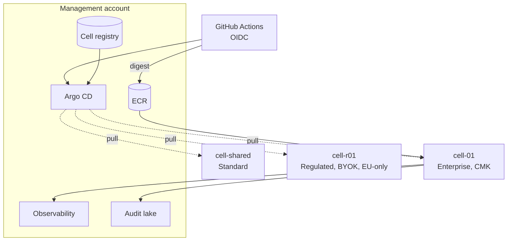
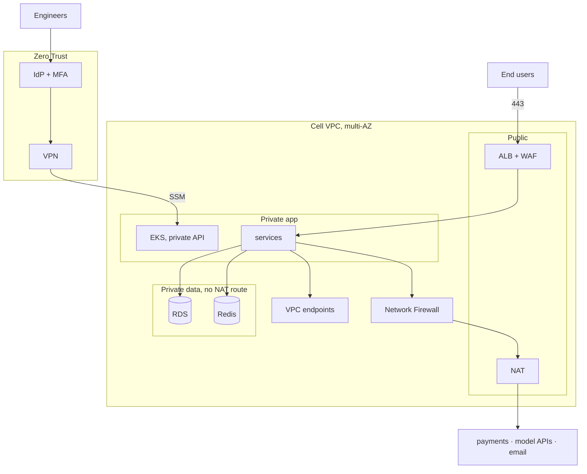

# Acme Platform — Architecture & Security Design

Multi-tenant B2B SaaS, AWS `eu-central-1`, three tiers, SOC 2 Type II, GDPR.
~10 Node.js services, PostgreSQL, Redis, S3, async jobs, WebSockets. Placeholders only.

## 1. Summary

The **cell** is the unit of isolation, deployment and operations: one VPC, cluster, database, cache, bucket, keys. Standard shares a cell; Enterprise and Regulated get their own AWS account.

- Isolation is an account boundary, not a config flag.
- One Terraform module, one chart, one image digest. Drift is a bug.
- Control plane is pull-based: cells pull from Argo CD, nothing reaches inbound.
- No public K8s API, no long-lived keys, no standing production privilege.

## 2. Architecture

The registry records which cells exist, at what tier, on what version. Customer 21 is a registry entry, not a new pipeline.

## 3. A1 — Tiers

| | Standard | Enterprise | Regulated |
|---|---|---|---|
| Account | shared | per customer | per customer, EU-only SCP |
| Compute | shared EKS | dedicated EKS | dedicated EKS + nodes |
| Database | shared RDS, RLS | dedicated RDS | dedicated RDS, CMEK |
| Redis / S3 | shared, per-tenant prefix | dedicated | dedicated, Object Lock |
| Ingress | shared ALB | dedicated ALB | dedicated ALB, PrivateLink, IP allowlist |
| Keys | platform CMK | per-cell CMK | BYOK, revocable |
| Backups | PITR 7d | PITR 14d + offsite | PITR 35d, cross-region EU |
| **RTO / RPO** | **4 h / 15 min** | **2 h / 5 min** | **1 h / 5 min** |
| Egress | shared NAT + allowlist | per-cell allowlist | per-cell, deny-default, logged |
| Cost / complexity | 1×, low | 8–12×, medium | 15–20×, high |

Standard is logically isolated (RLS, prefix policies), so a tenant-scoping bug is a cross-tenant incident — RLS is mandatory and tested in CI. Enterprise isolates at the account boundary. Regulated adds residency and customer-held keys.

## 4. A2 — Network & access

| Actor | Requirement | Mechanism |
|---|---|---|
| End users | gateway only | ALB + WAF on 443, no other public listener |
| Engineers | no public K8s API | private endpoint, VPN + PrivateLink, SSM only — no port 22, no bastion |
| Support | one cell only | per-cell permission set, read-only RBAC, no DB credentials, sessions recorded |
| Service-to-service | private, segmented | default-deny NetworkPolicies, mTLS, data subnets have no NAT route |

**Egress:** default-deny. AWS services via VPC endpoints. Internet traffic hits an FQDN allowlist in Network Firewall, held per tier in the registry; everything else drops and alerts. Changes go through pull request.

## 5. A3 — Identity, secrets, keys

- **Humans:** Identity Center only, MFA, ≤1 h sessions, no IAM users.
- **CI:** GitHub OIDC, no AWS keys. Two roles — build (branch-pinned) and deploy (environment-pinned).
- **Workloads:** IRSA per ServiceAccount, scoped to its own secret path and S3 prefix.
- **Secrets:** Secrets Manager per cell, projected by ESO, read via `secretKeyRef`. Never in values, images or state.
- **Rotation:** managed 30-day DB master; dual-key overlap for JWT; provider-side for payment keys.
- **Keys:** per-cell KMS, annual rotation, separate data and log keys. Regulated imports and can revoke its own material.
- **Break-glass:** second approver, ticket, 60-minute expiry, pages security, reviewed next business day.

## 6. A4 — Kubernetes

- Shared cluster for Standard, one per cell for dedicated tiers. Separate node groups keep async jobs off the request path.
- Namespace per service with quotas; default-deny NetworkPolicies; ServiceAccount per workload.
- Platform components everywhere via GitOps: LB controller, cert-manager, ESO, Kyverno, mesh for mTLS, OTel, Argo CD, Argo Rollouts, Karpenter.
- PSA `restricted`. Kyverno enforces non-root, read-only rootfs, no privilege escalation, dropped capabilities, limits, digest-pinned images from the platform registry.
- Images scanned twice: Trivy before push, ECR enhanced scanning after.

## 7. A5 — Data

- **PostgreSQL:** RDS Multi-AZ, encrypted with the cell CMK, `verify-full`, PITR, deletion protection, private subnets. Standard adds RLS and RDS Proxy.
- **Redis:** ElastiCache, encrypted, private. Cache and fan-out only, never system of record.
- **S3:** per cell, SSE-KMS, versioning, public access block, TLS-only policy, Object Lock for Regulated.
- **Standard → Enterprise:** logical dump, DMS with CDC, checksum verify, <15 min write freeze, DNS cutover, source read-only until sign-off.
- **Restore:** monthly rehearsal per tier, timed and recorded. Regulated keeps an EU pilot light so a 1-hour RTO is reachable.

## 8. A6 — CI/CD

- Build once, promote by digest. SBOM, scan report and builder identity retained.
- Waves: internal → canary → Standard → Enterprise batches → Regulated in agreed windows, each soaking on SLO burn rate.
- Argo Rollouts canary 10→25→50→100%, gated on error rate, p95 and 5xx, aborting on breach.
- Migrations expand/contract, so rollback never un-migrates. Rollback under 10 minutes.
- CI reaches the private cluster over an SSM tunnel; at fleet scale Argo CD's pull model replaces it.
- **DR drill, quarterly:** restore snapshot into an isolated account, re-apply Terraform, deploy the digest, smoke, measure against tier RTO/RPO, record findings. Regulated also confirms no data left the EU.

## 9. A7 — Observability & SOC 2

OTel per cell: metrics to AMP, logs to CloudWatch and the central store, traces to Tempo. Every line carries `cell_id`, `tenant_id`, `service`, `version`, `request_id`. Alerts on SLO burn rate; break-glass, egress denials, GuardDuty findings and CloudTrail changes always page. Audit logs 13 months in an Object-Locked bucket in a separate account.

| Control | Implementation | Evidence |
|---|---|---|
| **CC6.1** access | Identity Center + MFA, no IAM users, private API, IRSA, gated break-glass | access reviews, CloudTrail, IAM diffs |
| **CC6.6** boundary | private subnets, default-deny policies, FQDN allowlist, WAF | plan output, scanner reports, egress logs |
| **CC6.7** encryption | TLS 1.2+, `verify-full`, mTLS, KMS CMK everywhere | KMS inventory, Config snapshots |
| **CC7.2** monitoring | GuardDuty, Config, org CloudTrail, SLO and egress alerts | alert history, incident tickets |
| **CC7.4** incident response | on-call, severity matrix, review in 5 days | timelines, PIRs, drill reports |
| **CC8.1** change | required review, CI gates, environment approval, immutable digests | PR approvals, workflow logs, SBOM |
| **A1.1/A1.2** availability | Multi-AZ, PITR, cross-region for Regulated, quarterly drills | drill timings, backup dashboards, SLO reports |

Evidence is a byproduct of normal operation, not assembled before an audit.

## 10. A8 — Onboarding

| Phase | Steps | Target |
|---|---|---|
| Intake | record tier, region, retention, key model, deploy window, DPA terms in the registry | 1 d |
| Provisioning | Control Tower account with tier SCPs, then `provision-cell.sh` — VPC, endpoints, KMS, IAM, RDS, S3, ECR, secrets, all audit-logged | 2 d |
| Bootstrap | Argo CD registers the cell, installs platform components, seed secrets entered interactively | 0.5 d |
| DNS & TLS | hostname or customer CNAME, cert via cert-manager, WAF and rate limits | 0.5 d |
| Deploy | promoted digest with tier overlay, migrations expand-first | 0.5 d |
| Smoke | health, auth, a transaction, WebSocket, an export, a restore rehearsal, no cross-cell reach | 1 d |
| Handoff | support permission set, on-call routing, dashboards, runbook | 0.5 d |
| Steady state | promotion waves, monthly access review, quarterly DR drill, annual key rotation | ongoing |
| Offboarding | revoke access, final export, `terraform destroy` with snapshots, schedule BYOK key deletion, purge registry and monitoring, certificate of deletion | ≤30 d, GDPR Art. 17 |

## 11. Top 5 risks

| # | Risk | Impact / likelihood | Mitigation | Residual |
|---|---|---|---|---|
| 1 | cross-tenant exposure in the shared cell | critical / medium | RLS enforced by migration lint, scoping tests, query audit logging | accepted for Standard only; Enterprise otherwise |
| 2 | fleet drift and patch lag | high / high if manual | one module and chart, GitOps auto-heal, version dashboard, no manual apply | Regulated still needs windows, covered contractually |
| 3 | CI/CD supply-chain compromise | critical / low–medium | OIDC pinned to repo, branch, environment and workflow; audit and Trivy gates; immutable digests; approval; registry allowlist | insider with review rights remains possible |
| 4 | BYOK revocation or loss | high / low | contractual acknowledgement, key-state alerting, re-key procedure, rehearsed in drills | deliberately accepted — it is the control being paid for |
| 5 | per-cell cost outgrows contract value | medium / high as fleet grows | cost tags, endpoints over NAT, Karpenter, Graviton, pricing floors from real cost | accepted; the failure to avoid is quietly re-sharing |

**Trade-offs.** Account-per-cell over namespace-per-customer: more cost, hard blast radius. Pull-based GitOps: more in-cluster parts, no inbound access. Private-only API: worse ergonomics, removes the most attacked surface. Expand/contract migrations: slower delivery, rollbacks that always work.

## 12. Roadmap

| Phase | Weeks | Exit criteria |
|---|---|---|
| 0 Foundations — Organizations, SCPs, Identity Center, audit lake, state backend, OIDC | 1–4 | no IAM users, every account on the org trail |
| 1 Reference cell — module, chart, `cell-01`, pipeline with OIDC and approval | 5–9 | cell-01 serving traffic, no secrets in git, scanners clean |
| 2 Fleet automation — registry, provisioning script, Argo CD hub, waves, drift detection | 10–14 | new cell in under a day, no manual cluster access |
| 3 Compliance — Kyverno enforcing, PSA restricted, GuardDuty/Config, evidence automation, first DR drill | 15–20 | evidence produced automatically, drill meets RTO/RPO |
| 4 Regulated — EU-only SCPs, BYOK ceremony, cross-region EU backup, residency pack | 21–26 | first Regulated cell live, controls verified |
| 5 Scale — Karpenter, Graviton, NAT tuning, RLS audit automation | ongoing | cost trending down, Type II window completed |

Phases 0–1 build what everything else copies. Compliance lands in phase 3 because Type II needs an observation period of controls operating.
